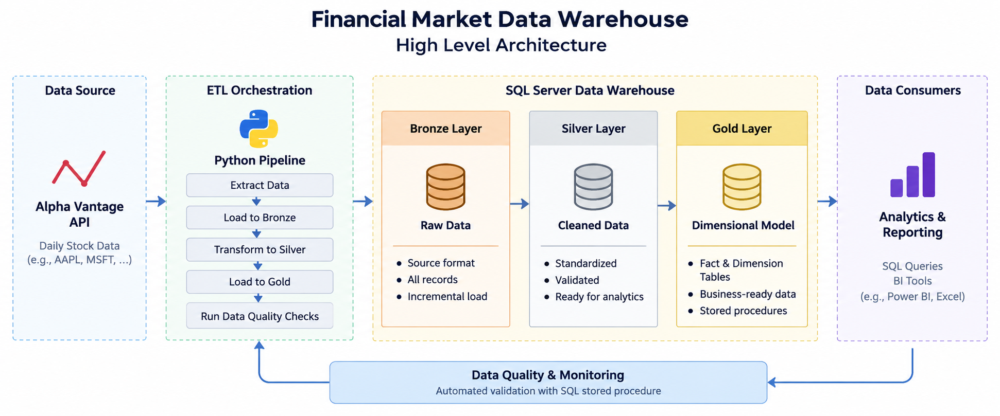
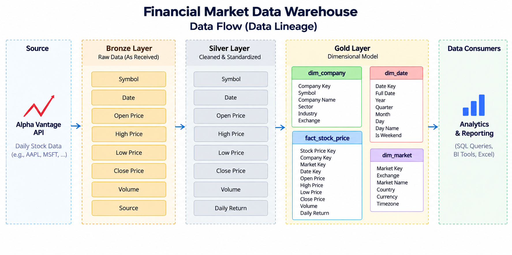
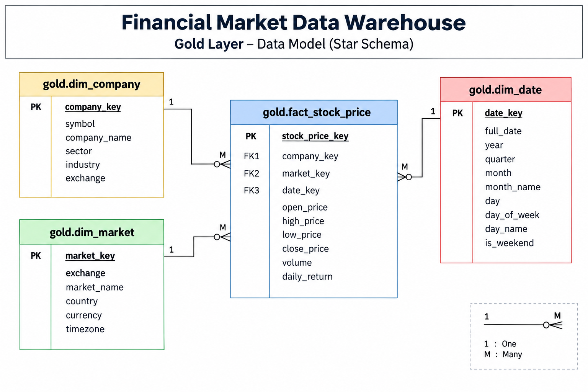

# Financial Market Data Warehouse

**One-line summary:** An end-to-end Python and SQL Server pipeline that ingests daily stock-market data, processes it through Bronze, Silver, and Gold layers, and validates the warehouse with 16 automated data-quality checks.

---

## Table of Contents

- [Overview](#overview)
- [Problem Statement](#problem-statement)
- [Dataset](#dataset)
- [Tools and Technologies](#tools-and-technologies)
- [Methods](#methods)
- [Key Insights](#key-insights)
- [Dashboard / Model / Output](#dashboard--model--output)
- [How to Run This Project](#how-to-run-this-project)
- [Results and Conclusion](#results-and-conclusion)
- [Future Work](#future-work)
- [GitHub Repository Structure](#github-repository-structure)
- [Author and Contact](#author-and-contact)

---

## Overview

This project builds a financial market data warehouse using the Alpha Vantage API, Python, and Microsoft SQL Server. The pipeline extracts daily stock data, loads it into a Bronze layer, transforms it in Silver, and organizes it into a Gold-layer star schema for analytical queries.

The pipeline is orchestrated through Python and includes ingestion logging, duplicate-prevention logic, stored-procedure-based transformations, and automated warehouse validation.

## Problem Statement

Raw financial data from an external API is not automatically ready for reliable analysis. It needs to be collected, standardized, organized, and checked for data-quality issues.

The goal of this project is to build a structured and traceable warehouse that:

- Collects stock-market data from an external API.
- Preserves incoming records in a Bronze layer.
- Standardizes data through Silver-layer transformations.
- Organizes analytical data in a Gold star schema.
- Tracks pipeline executions and handles errors.
- Prevents repeated insertion of existing stock-date records.
- Validates the warehouse before reporting a successful run.

## Dataset

**Source:** [Alpha Vantage API](https://www.alphavantage.co/)

The pipeline is configured for 10 stock symbols:

`AAPL`, `MSFT`, `NVDA`, `AMZN`, `GOOGL`, `META`, `TSLA`, `JPM`, `NFLX`, and `AMD`.

The daily dataset contains OHLCV fields:

- **Open:** Opening price
- **High:** Highest price of the day
- **Low:** Lowest price of the day
- **Close:** Closing price
- **Volume:** Number of shares traded

The initial extraction returned 1,000 records (10 stocks × 100 observations). The repository also includes a sample raw response at `data/sample/AAPL_raw.json`.

## Tools and Technologies

| Tool / Technology | Purpose |
|---|---|
| Python | API extraction and pipeline orchestration |
| Alpha Vantage API | Daily stock-market data source |
| Requests | HTTP API requests |
| Pandas | Parsing and combining tabular data |
| Microsoft SQL Server | Data warehouse storage |
| T-SQL | Tables, stored procedures, views, and quality checks |
| pyodbc | Python-to-SQL Server connectivity |
| python-dotenv | Loading environment configuration |
| Git and GitHub | Version control and project sharing |

## Methods

### 1. Data Extraction

- Read the configured stock symbols from `config/stocks.json`.
- Used a reusable API client to request daily stock data from Alpha Vantage.
- Added request timeouts and handling for HTTP errors, API errors, and rate-limit messages.
- Parsed the API response into Pandas DataFrames and standardized the data types.

### 2. Bronze Layer — Raw Data

- Stored incoming stock records in SQL Server.
- Generated a unique `ingestion_id` for each pipeline execution.
- Logged run status, timestamps, record counts, and error details.
- Used `WHERE NOT EXISTS` to skip records already present for the same symbol and observation date.

### 3. Silver Layer — Standardized Data

- Executed `silver.usp_load_stock_price` from Python.
- Kept transformation logic in SQL Server stored procedures.
- Used transaction handling to commit successful operations or roll back failed operations.

### 4. Gold Layer — Dimensional Model

Created a star schema containing one fact table and three dimension tables:

| Table | Purpose |
|---|---|
| `gold.fact_stock_price` | Stock-price measures, volume, daily return, and dimension keys |
| `gold.dim_company` | Company and stock-symbol details |
| `gold.dim_market` | Market and exchange details |
| `gold.dim_date` | Date attributes such as year, quarter, month, and day |

**Fact-table grain:** One company × one market × one trading date.

Gold loading is coordinated through `gold.usp_load_all`, which loads the dimensions before the fact table. The project also includes analytical views for daily stock performance, company performance, and market performance.

### 5. Data Quality and Pipeline Control

The Python orchestrator runs extraction, Bronze loading, Silver transformation, Gold loading, and final validation in sequence.

The `gold.usp_run_data_quality_checks` procedure performs 16 checks covering:

- Bronze, Silver, Gold fact, and dimension record counts
- Duplicate Gold fact records
- Missing and orphaned dimension keys
- Invalid OHLC price relationships
- Invalid trading volume
- Missing financial measures

Python displays the actual and expected values, failed-row counts, and PASS/FAIL status. If any check fails, the pipeline is reported as failed rather than successful.

## Key Insights

This project focuses on building the data foundation for analysis rather than claiming specific investment findings.

- The Gold star schema makes it possible to analyze stock observations by company, market, and date.
- The analytical views provide a simpler starting point for comparing daily performance, company performance, and market-level measures.
- Ingestion logs make pipeline runs easier to trace and troubleshoot.
- Duplicate-prevention logic avoids repeatedly inserting existing symbol-date records during normal sequential runs.
- Automated quality checks can identify invalid records and prevent a failed validation from being reported as a successful run.

## Output

**This project does not include a dashboard.** Its main output is a SQL Server data warehouse with analytical views and automated data-quality validation.

### 1. High-Level Architecture




### 2. Data Flow (Data Lineage)




### 3. Gold Layer Data Model (Star Schema)




## How to Run This Project

### Prerequisites

- Python installed
- Microsoft SQL Server and a compatible ODBC driver installed
- An Alpha Vantage API key
- The warehouse database and SQL objects created using the scripts in `sql/`

### Setup

1. Clone or download this repository.
2. Install the Python dependencies:

   ```bash
   pip install -r requirements.txt
   ```

3. Create a local `.env` file using `.env.example` as a reference. Configure the variables expected by the Python code, including:

   ```text
   ALPHA_VANTAGE_API_KEY=your_alpha_vantage_api_key
   SQL_SERVER=your_sql_server
   SQL_DATABASE=FinancialMarketWarehouse
   SQL_DRIVER=ODBC Driver 17 for SQL Server
   ```

   Use the SQL Server driver installed on your machine. Keep `.env` private and do not commit it to GitHub.

4. Run the SQL scripts in the appropriate order, starting with database creation and continuing through schemas, Bronze, Silver, Gold, views, and validation.
5. Test connectivity if needed:

   ```bash
   python src/test_api.py
   python src/test_database.py
   ```

6. Run the complete pipeline:

   ```bash
   python src/main.py
   ```

For more detailed setup guidance, see [`docs/setup.md`](docs/setup.md).

## Results and Conclusion

The project demonstrates an end-to-end financial data warehousing workflow using Python and SQL Server.

A recorded successful warehouse state included:

- 1,020 Bronze records
- 1,020 Silver records
- 1,020 Gold fact records
- 10 company dimension records
- 1 market dimension record
- 148 date dimension records
- **16 out of 16 data-quality checks passed** in a successful validation run

The initial extraction returned 1,000 records, while the recorded warehouse state contained 1,020 records; these are separate recorded counts and should not be treated as the same batch.

Overall, the project demonstrates API integration, layered warehouse design, SQL stored procedures, star-schema modeling, ingestion tracking, duplicate prevention, and automated data-quality validation.

## Future Work

- **Automated Scheduling:** Schedule the pipeline to run regularly after daily market data becomes available.
- **Monitoring and Alerts:** Add notifications for API errors, database failures, and failed quality checks.
- **Historical Data Updates:** Implement an upsert strategy for corrected stock prices on previously loaded dates.
- **Expanded Coverage:** Add more stocks, exchanges, or financial data sources.
- **Performance Improvements:** Review SQL indexing, query performance, and loading strategies as the warehouse grows.

## GitHub Repository Structure

```text
financial-market-data-warehouse/
│
├── README.md
├── requirements.txt
├── .gitignore
├── .env.example
│
├── config/
│   └── stocks.json
│
├── data/
│   └── sample/
│       └── AAPL_raw.json
│
├── docs/
│   ├── images/
│   │   ├── project_architecture.png
│   │   ├── data_flow.png
│   │   └── data_model.png
│   ├── architecture.md
│   ├── data_model.md
│   ├── data_flow.md
│   ├── data_catalog.md
│   ├── naming_conventions.md
│   ├── etl_pipeline.md
│   ├── data_quality.md
│   └── setup.md
│
├── sql/
│   ├── 01_database/
│   │   └── create_database.sql
│   ├── 02_schemas/
│   │   └── create_schemas.sql
│   ├── 03_bronze/
│   │   ├── create_tables.sql
│   │   └── ingestion_log.sql
│   ├── 04_silver/
│   │   ├── create_tables.sql
│   │   └── load_silver.sql
│   ├── 05_gold/
│   │   ├── create_dimensions.sql
│   │   ├── create_fact.sql
│   │   ├── load_dimensions.sql
│   │   ├── load_fact.sql
│   │   └── load_all.sql
│   ├── 06_views/
│   │   └── analytical_views.sql
│   └── 07_validation/
│       └── data_quality_checks.sql
│
└── src/
    ├── __init__.py
    ├── api_client.py
    ├── bronze_loader.py
    ├── data_parser.py
    ├── database.py
    ├── gold_loader.py
    ├── ingestion.py
    ├── main.py
    ├── silver_loader.py
    ├── test_api.py
    ├── test_database.py
    └── warehouse_validation.py
```

## Author and Contact

**Author:** Pronoy Pryunkush Sonowal

-   **GitHub:** https://github.com/Pronoy-2003
-   **LinkedIn:** www.linkedin.com/in/pronoy-pryunkush-sonowal
-   **Email:** pronoypryunkushsonowal2002@gmail.com

---

*This project was developed for portfolio and learning purposes, with a focus on data engineering and data warehousing.*
